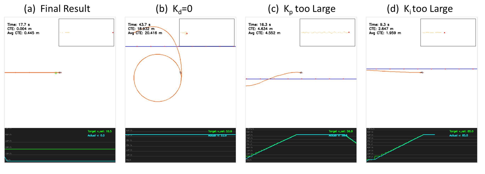
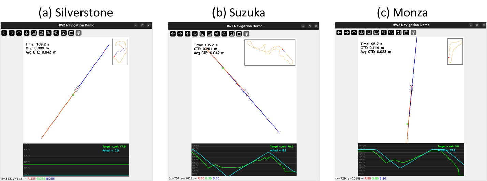

# Robotic Navigation and Exploration – Path Tracking

Kinematic vehicle models (basic, differential-drive, bicycle) and lateral/longitudinal path-tracking controllers (PID, Pure Pursuit, Stanley, LQR), tested on real F1 circuits (Silverstone, Suzuka, Monza). Built for the "Robotic Navigation and Exploration" course (NTHU).

> The original project description (written by the course instructor) is not included here for copyright reasons. It can be found here: [Project description](https://drive.google.com/file/d/1PAM7s0XXkES9RXhLmbd79fSCX7Yu8zGY/view?usp=drive_link).

> My own written report: [report](https://drive.google.com/file/d/1F1707v_WjYGlHK1V-SAI9hR7jrJyWnPK/view?usp=drive_link).

## Structure

```
code/
├── navigation.py          # Entry point (python navigation.py -s <model> -c <controller> -t <track>)
├── navigation_utils.py
├── trajectory_generator.py
├── Simulation/             # Kinematic models (basic, differential-drive, bicycle) + simulators
├── PathTracking/           # Controllers: PID, Pure Pursuit, Stanley, LQR
└── tracks/                 # Track data (Silverstone, Suzuka, Monza, straight-line test tracks)
docs/                      # Figures referenced below
```

## PID Control in the Basic Model

For lateral control, the PID controller's gains `Kp`, `Ki`, `Kd` were tuned manually to achieve the best tracking performance (final: `Kp = 1, Ki = 0.2, Kd = 0.5`), adjusting one term at a time. In my case:

```
python navigation.py -s basic -c pid -t 1000mStraight --init_shift 1.5
```
- **Derivative** dampens the response by predicting future error. At `Kd = 0` the vehicle overshot and drove in circles; `Kd = 0.5` smoothed the steering and stabilized the trajectory.
- **Proportional** drives steering from the current error. Too high (`Kp = 5`) caused wild oscillation/overcorrection; `Kp = 1` gave stable, responsive tracking.
- **Integral** corrects accumulated steady-state error. Too high caused instability and more cross-track error; `Ki = 0` is fine on straight paths, but `Ki = 0.2` is needed so the vehicle can still handle upcoming curves smoothly.



*(a) Final tuned result — low, stable cross-track error. (b) `Kd=0` — overshoots into circles. (c) `Kp` too large — oscillates. (d) `Ki` too large — unstable correction.*

## F1 Track Challenge

Given the full set of kinematic models and controllers, the task was to pick whichever combination performs best — averaged across all three F1 circuits (Silverstone, Suzuka, Monza) — under a scoring rule that penalizes both completion time and tracking error (with tracking error weighted more heavily).

I tried several combinations before settling on the final one:
- **PID** — oscillated and recovered slowly from sharp turns.
- **Pure Pursuit** — cut inside curves and went unstable at high curvature.
- **Stanley** — fixed that instability but wasn't as accurate.
- **LQR on steering angle (final choice)** — gave the smoothest, most accurate tracking by balancing lateral and heading error in one cost function.
- **LQR on steering angular velocity** — added an extra integration step that left residual steady-state error gain tuning couldn't remove.

**Model + controller used: Bicycle kinematic model + LQR control (steering angle).**

```
python navigation.py -s bicycle -c lqr -t [Silverstone|Suzuka|Monza]
```



Results: **Silverstone** — 109.2s, avg CTE 0.043m · **Suzuka** — 105.2s, avg CTE 0.042m · **Monza** — 95.7s, avg CTE 0.023m. Low, consistent cross-track error across all three tracks (not just low completion time), which is what the scoring rule rewards since tracking accuracy is penalized more heavily than speed.
